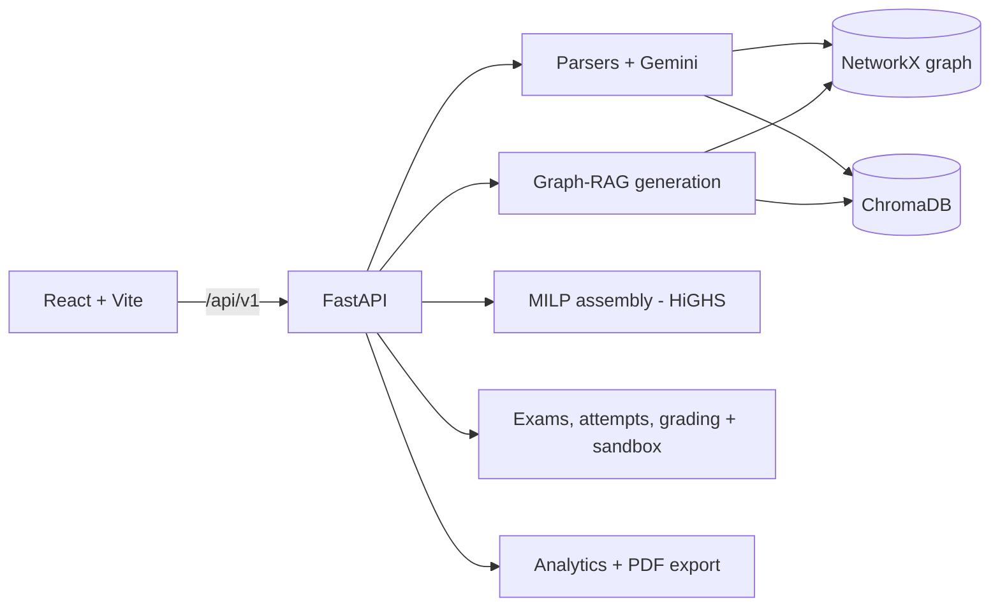

# SynapSet

Assessment platform for teachers: upload course material, build a knowledge graph, generate
grounded exam questions, assemble papers against MSE/SEE patterns, run timed exams, grade, and analyse.

## Features
- **Ingestion:** PDF/DOCX/PPTX/TXT -> Gemini topic extraction -> per-subject knowledge graph (PageRank) + ChromaDB vector index.
- **Question generation:** Graph-RAG with Gemini: retrieved syllabus text plus graph relations. 7 question types, including coding questions auto-checked in a sandbox. Teacher-written questions are classified by AI.
- **Difficulty and duplicates:** XGBoost + SHAP difficulty score (trained on synthetic labels); semantic + topic + structural duplicate detection.
- **Paper assembly:** exam patterns (MSE/SEE) solved as a MILP (SciPy/HiGHS) over Bloom's, difficulty, unit and course-outcome targets, with AI gap-filling and a live compliance check. Paper review with PDF export.
- **Exams:** scheduling, server-side timing, autosave/resume, auto + manual grading.
- **Students:** public exam links or accounts with join codes, dashboard and results.
- **Analytics:** class, assessment and topic-risk views.

## Architecture


## Run locally
```bash
cp .env.example .env                          # set GOOGLE_API_KEY
pip install -r requirements.txt
python -m uvicorn app.main:app --port 8000    # no --reload on Windows
npm install && npm run dev                    # http://localhost:5173
```
Students join via `/take/<examId>` or `/student`. Tested on Python 3.13.

## Tests
`pytest` runs about 280 tests with no network. `pip install -r requirements-eval.txt && pytest -m eval`
runs LLM evals (relevance, faithfulness, hallucination) with DeepEval on a 26-case golden dataset; it uses Gemini quota.

## History
An earlier version assembled whole papers with an OR-Tools CP-SAT optimizer; it was later rebuilt on
SciPy's MILP solver (see commits `7e8d536` and `372fc2e`).

## Known limitations
JSON/pickle stores (single process), a best-effort code sandbox, and a difficulty model trained on
synthetic labels. See `SYNAPSET_DEVELOPMENT_CONTEXT.md` section 12 for the full list.
